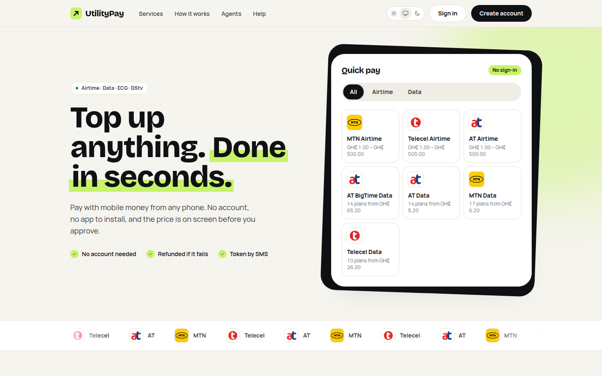
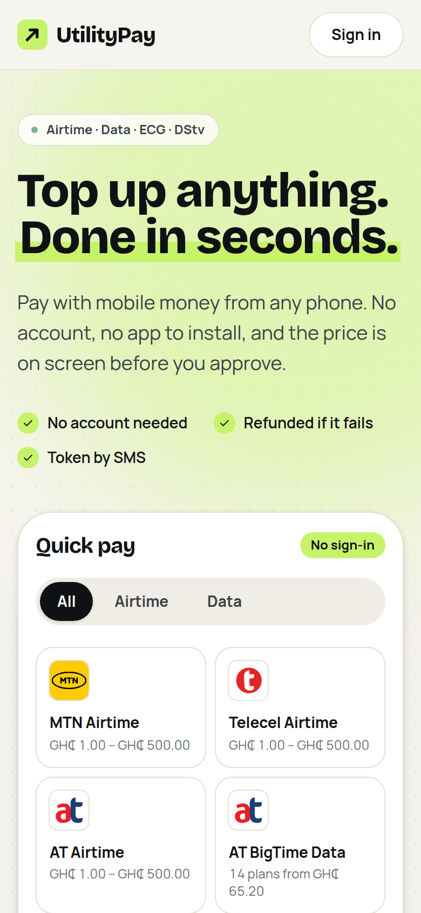

# UtilityPay

**Top up anything, done in seconds.** Airtime, data, electricity (ECG) and DStv payments for Ghana. USSD-first, with a web app for customers, agents and the back office, all on one transaction engine.

[**Live site →**](https://utility-pay-web.vercel.app) &nbsp;·&nbsp; Next.js · NestJS · PostgreSQL · Redis

> This repository is a product showcase. The source code is private; I'm happy to walk through it on a call.

  
  &nbsp;
  

## What it does

- **Pay without an account:** pick a product, see the price before you approve, pay with mobile money from any phone, and get refunded automatically if delivery fails.
- **Customers:** a wallet, saved accounts and beneficiaries, and purchase history.
- **Agents:** sell on behalf of customers and earn commissions.
- **Back office:** role-based access with an audit log, manual resolution, wallet adjustments, reconciliation and reports.
- **USSD:** a session engine with catalogue-driven menus, PINs and gateway adapters.

## Engineering

- **Money-safe:** wallets on a **double-entry ledger**, a pricing engine, and signed, deduplicated payment webhooks.
- **Reliable delivery:** BullMQ queues with retries, status checks and recovery sweeps, plus SMS and email notifications.
- **Web app:** Next.js customer purchase flow, wallet, agent commissions and a full back office, with light, dark and system themes.

**Stack:** NestJS (modular monolith), PostgreSQL, Prisma, Redis, BullMQ · Next.js, React, TypeScript, Tailwind CSS
